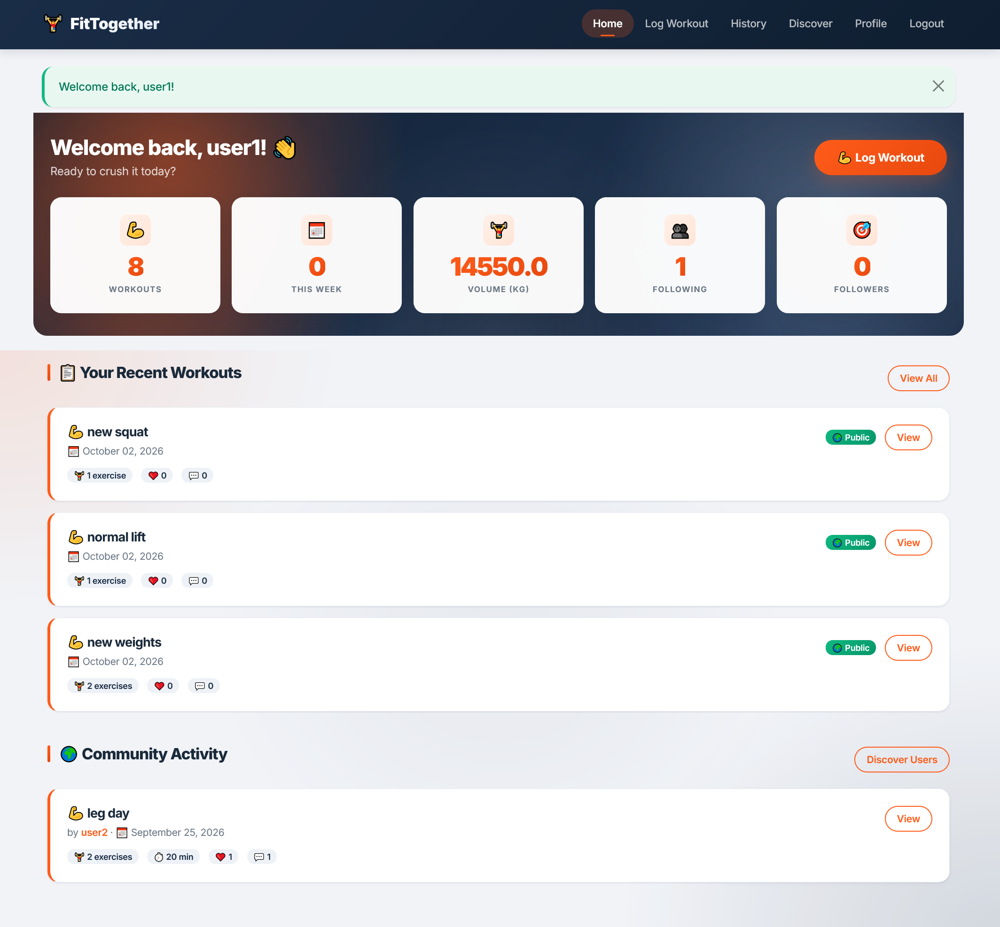
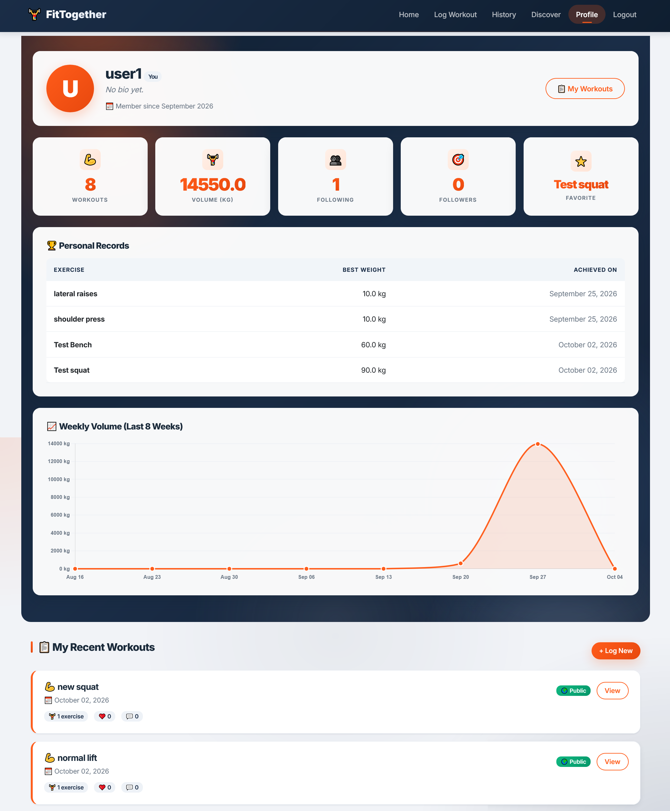
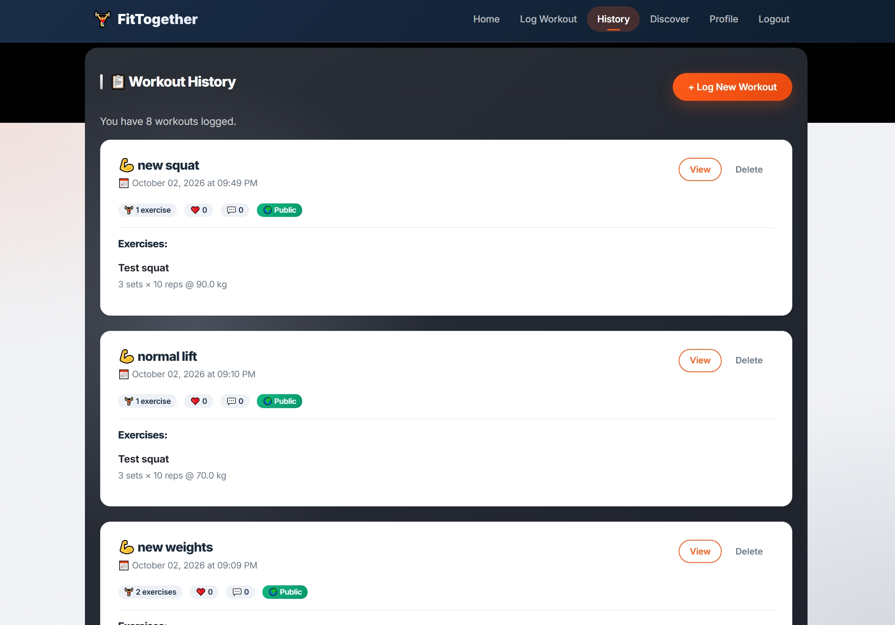
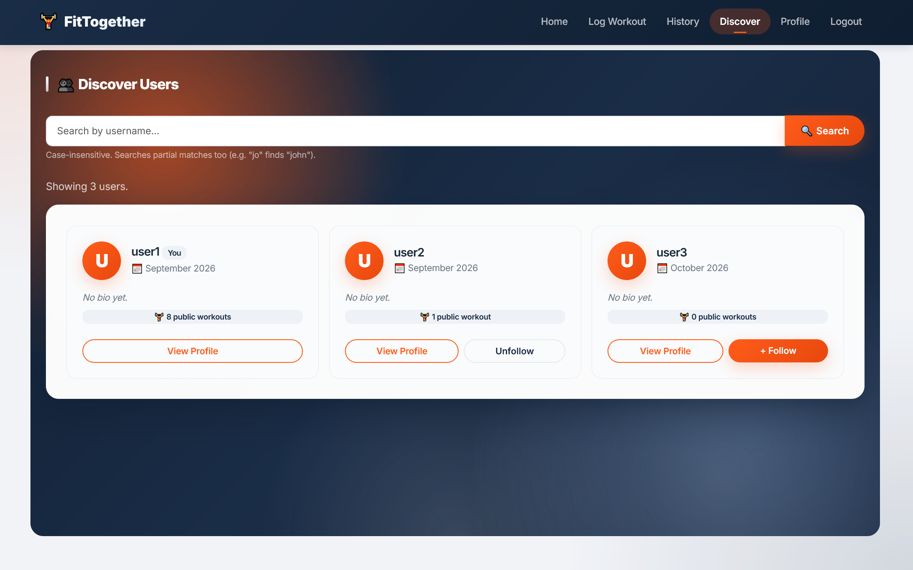
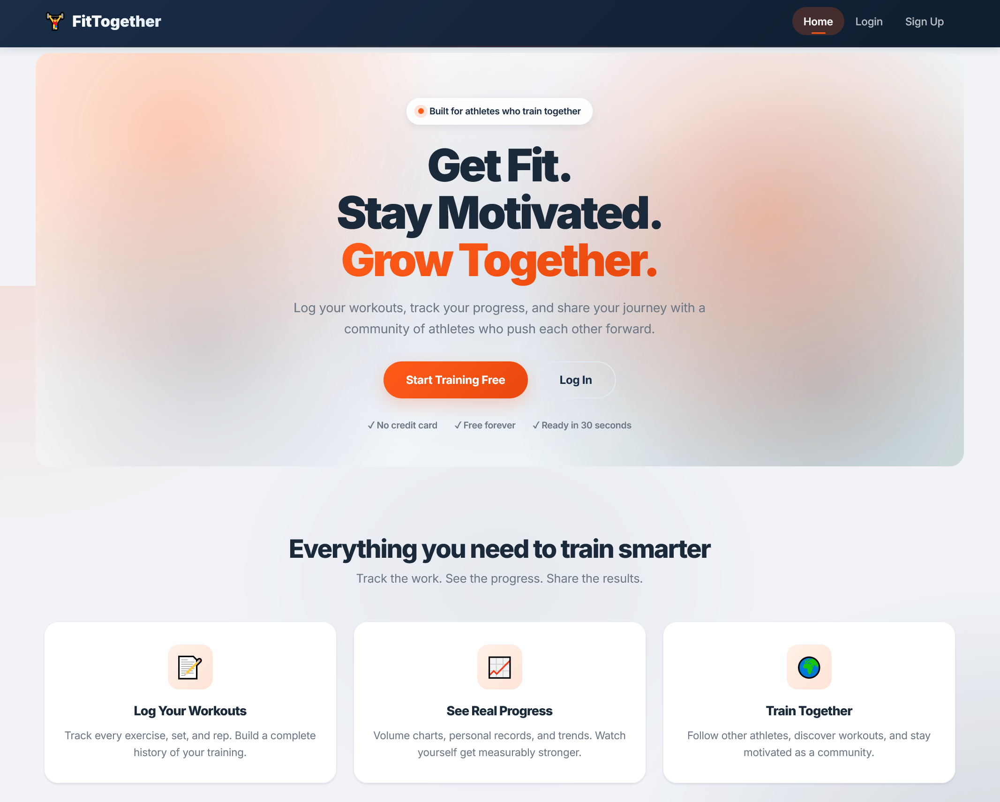
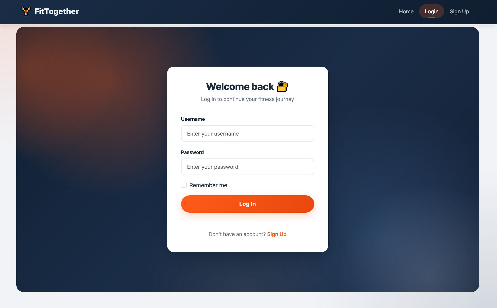
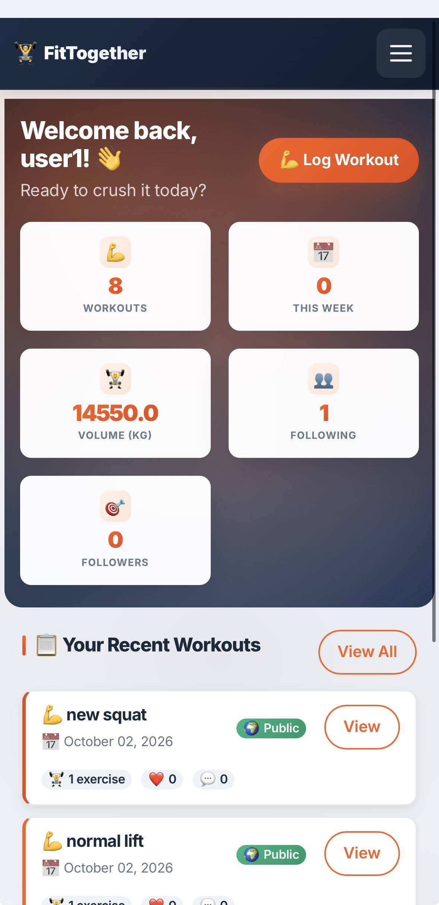
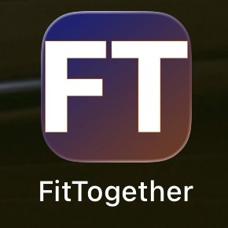
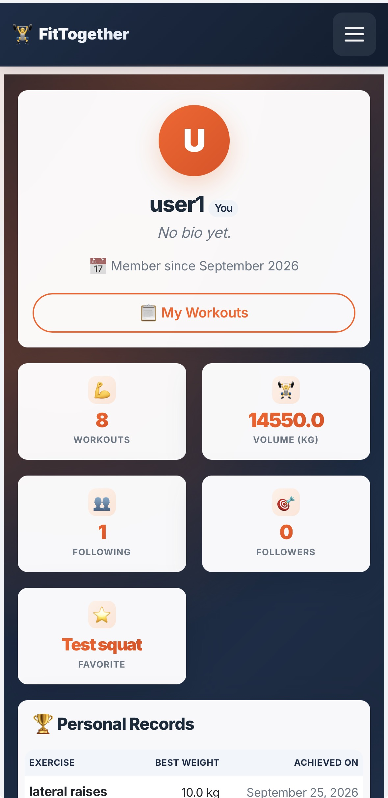

# 🏋️ FitTogether

**A social fitness web app where athletes log workouts, track progress, and train together.**

---

## 🚀 Live Demo

**👉 [<https://fittogether-okax.onrender.com>](<https://fittogether-okax.onrender.com>)**

> ⚠️ **Note:** The free tier spins down after 15 minutes of inactivity. First load may take 30-60 seconds to wake up. Subsequent loads are fast.

**📱 Installable as a PWA** — open the site on your phone and tap **"Add to Home Screen"**.

---

## 📸 Screenshots

### Desktop

| Homepage Dashboard | Profile with Personal Records & Chart |
|:---:|:---:|
|  |  |

| Workout History | Discover Users |
|:---:|:---:|
|  |  |

| Landing Hero | Login |
|:---:|:---:|
|  |  |

### Mobile (Installed as PWA)

| Home Screen Icon | Full-Screen App | Profile with Chart |
|:---:|:---:|:---:|
|  |  |  |

---

## ✨ Features

### 🏋️ Workout Tracking
- **Multi-exercise sessions** — log multiple exercises per workout
- **Detailed metrics** — sets, reps, weight (kg), duration, distance
- **Automatic volume calculation** — total kg lifted per session and per week
- **Personal records detection** — automatically spots PRs when logged
- **Weekly volume chart** — 8-week trend visualization with Chart.js

### 👥 Social Features
- **Public profiles** — every user has a profile at `/u/<username>`
- **Follow system** — follow/unfollow with follower/following lists
- **Community feed** — see workouts from people you follow
- **Likes & comments** — engage with other athletes' workouts
- **User discovery** — browse and search all users

### 🔒 Privacy & Security
- **Public or private workouts** — control what others see
- **Secure authentication** — bcrypt password hashing, Flask-Login sessions
- **Ownership checks** — users can only edit their own workouts
- **Cascade deletes** — deleting a workout removes its likes and comments

### 📱 Modern UX
- **Installable PWA** — add to home screen on iOS and Android
- **Fully responsive** — mobile-first design that feels native
- **Custom design system** — Inter font, brand colors, micro-animations
- **Accessible** — reduced-motion support, focus states, semantic HTML

---

## 🛠️ Tech Stack

| Layer | Technology |
|-------|-----------|
| **Backend** | Python 3.11, Flask 2.3 |
| **Database** | SQLite via SQLAlchemy ORM |
| **Auth** | Flask-Login, Werkzeug password hashing |
| **Templating** | Jinja2 |
| **Styling** | Bootstrap 5, custom CSS design system |
| **Charts** | Chart.js 4 |
| **Frontend** | Vanilla JavaScript (dynamic forms) |
| **Deployment** | Render (with Gunicorn) |
| **PWA** | Web App Manifest, custom icons |
| **Version Control** | Git + GitHub |

---

## 🗄️ Database Schema

| Table | Purpose |
|-------|---------|
| **users** | User accounts (auth, profile data) |
| **workouts** | Workout sessions (name, date, visibility) |
| **exercises** | Individual exercises within a workout |
| **follows** | Many-to-many follow relationships |
| **likes** | Workout likes (unique per user-workout) |
| **comments** | User comments on workouts |

---

## 📁 Project Structure